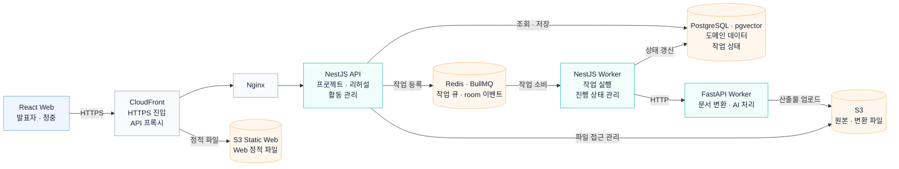

# Orbit 시스템 아키텍처

발표자·청중 요청은 API와 Socket.IO에서 처리하고, 문서 변환·음성 분석은 BullMQ와 Worker로 넘깁니다. 작업 상태는 PostgreSQL에, 발표자료와 음성 파일은 S3에 저장합니다.

## 기능별 흐름

- [실시간 청중 참여와 재접속](realtime.md)
- [리허설 음성 업로드와 리포트 생성](speech-report.md)
- [변환 파일 업로드와 메타데이터 전달](artifact.md)

## 관련 문서

- [로컬 환경과 서비스 구성](local-first-stack.md)
- [기술 스택 버전](tech-stack-versions.md)

[README](../../README.md#아키텍처)
