# 실시간 청중 참여와 재접속

```mermaid
flowchart LR
    n_audience["청중 입장·응답"]:::client
    n_api["세션·참여 권한 검사"]:::app
    n_db[("응답 저장·집계 갱신")]:::data
    n_event["Socket.IO 세션 room 이벤트"]:::app
    n_screens["발표자·청중 화면 갱신"]:::client
    n_reconnect["재접속"]:::client
    n_snapshot["현재 세션 상태 재조회"]:::app

    n_audience --> n_api
    n_api --> n_db
    n_db -->|"커밋 후"| n_event
    n_event --> n_screens
    n_screens -->|"연결 복구"| n_reconnect
    n_reconnect --> n_snapshot
    n_snapshot -->|"상태 재동기화"| n_screens

    classDef client fill:#eff6ff,stroke:#60a5fa,color:#17233b
    classDef edge fill:#f8fafc,stroke:#94a3b8,color:#17233b
    classDef app fill:#f0fdfa,stroke:#2bbbad,color:#17233b
    classDef data fill:#fff7ed,stroke:#fdba74,color:#17233b
    classDef external fill:#f5f3ff,stroke:#bda4ee,color:#17233b
    classDef decision fill:#f0fdfa,stroke:#2bbbad,color:#17233b
```

청중 응답을 저장하고 해당 발표 세션에 결과 갱신 이벤트를 전달합니다. 연결이 끊긴 화면은 재접속 후 현재 상태를 다시 조회합니다.

## 상세 문서

[참여 장표 실행·검증 문서](../runbooks/activity-slides.md)

[시스템 구조](overview.md) · [README](../../README.md#아키텍처)
