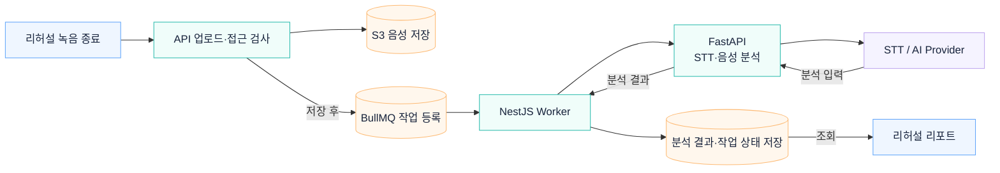

# 리허설 음성 업로드와 리포트 생성

녹음 파일을 저장한 뒤 분석 작업을 큐에 등록합니다. Worker가 음성 전사·분석을 실행하고 결과를 저장하면 리포트 화면에서 조회합니다.

## 상세 문서

[리허설 리포트 파이프라인 상세](../rehearsal-report/README.md)

[시스템 구조](overview.md) · [README](../../README.md#아키텍처)
