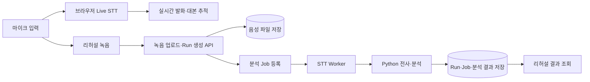
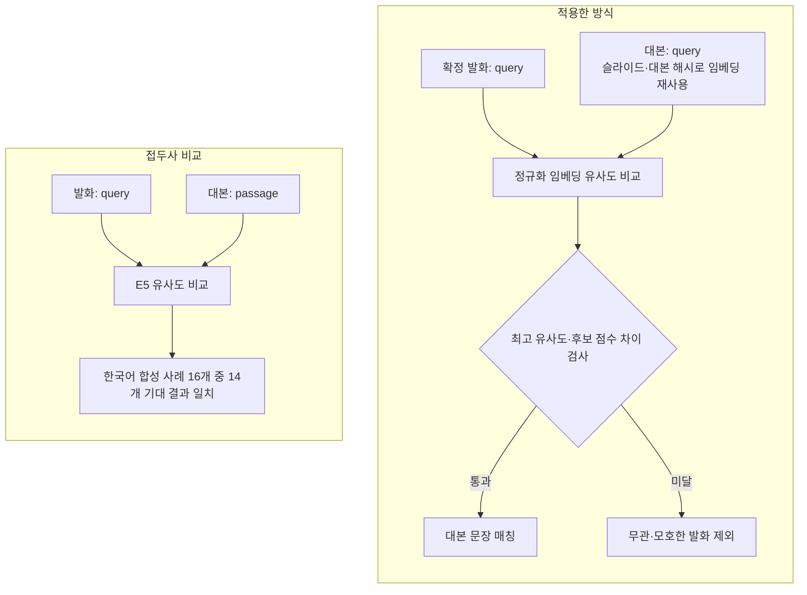
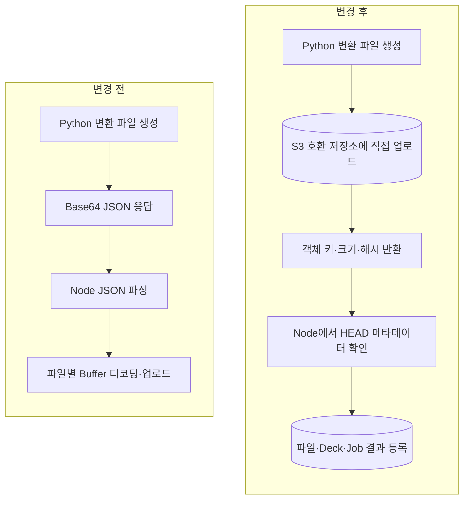
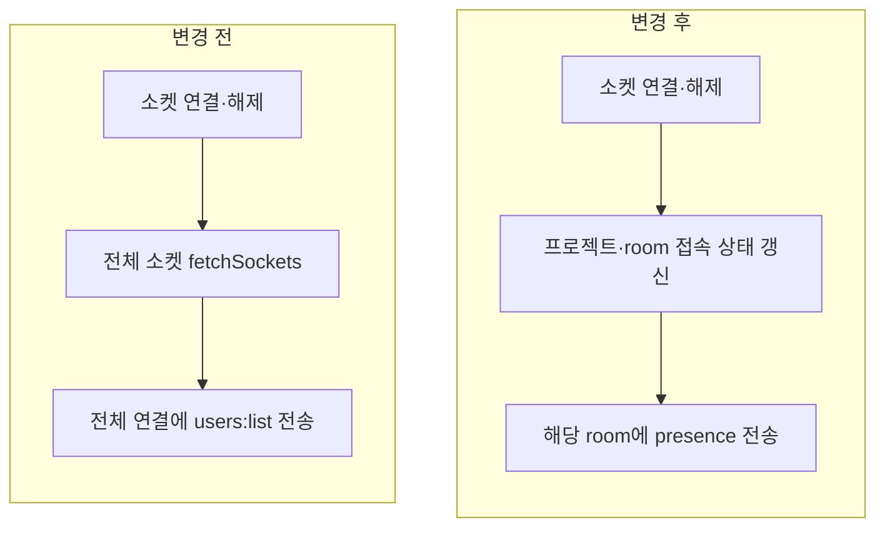
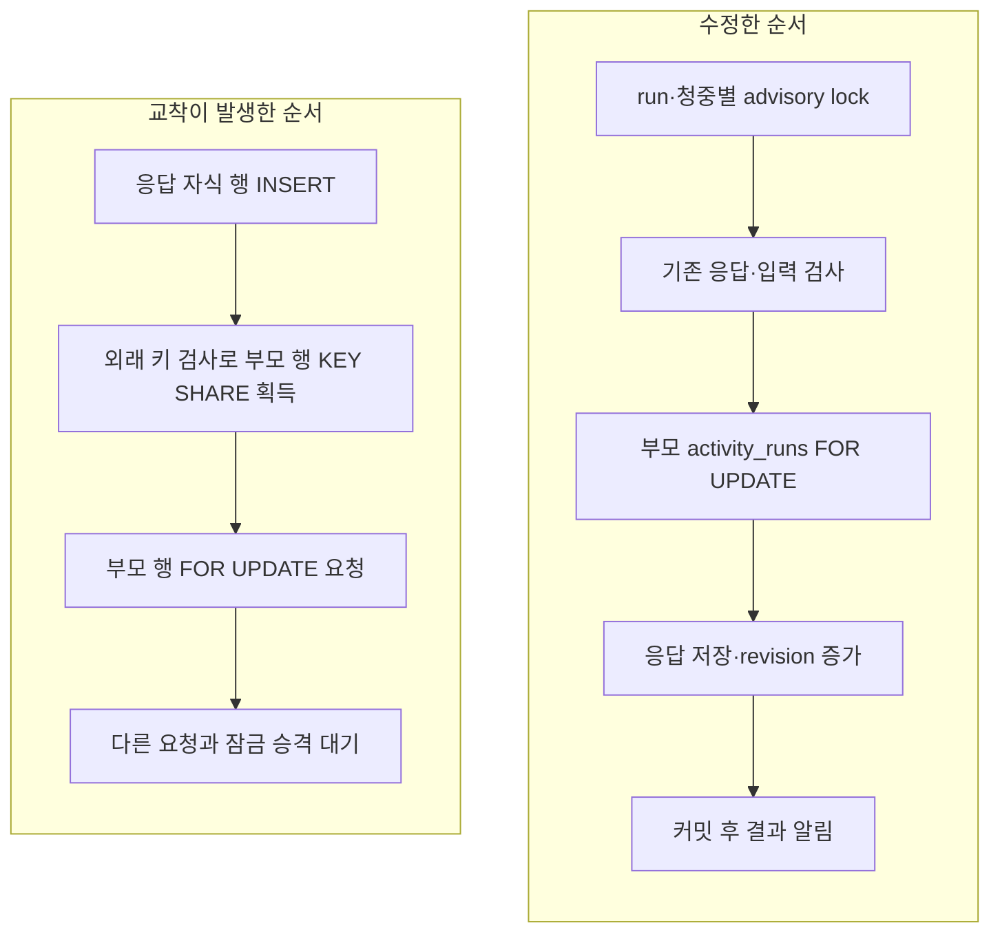

# 김동현 개인 구현

리허설 녹음 업로드와 STT 처리, 발화·대본 매칭, 문서 변환 파일 전달 경로를 구현했습니다. 이후 개인 저장소에서 실시간 전송과 청중 응답의 동시성을 개선했습니다.

| 구분           | 구현 내용                                     | 주요 변경                                                         |
| -------------- | --------------------------------------------- | ----------------------------------------------------------------- |
| 팀 프로젝트    | [리허설 STT 처리](#rehearsal-stt)             | 녹음 업로드 API, 분석 Job, Worker와 결과 저장 연결                |
| 팀 프로젝트    | [E5 발화·대본 매칭](#script-alignment)        | 의미 유사도·후보 점수 차이로 판정하고 대본 임베딩 재사용          |
| 팀 프로젝트    | [문서 변환 파일 전달](#artifact-storage)      | Python 직접 업로드와 저장 메타데이터 전달로 Node의 파일 복사 제거 |
| 개인 후속 개선 | [전역 소켓 목록 전송 제거](#socket-broadcast) | 전체 소켓 조회·전송을 제거하고 프로젝트·room 단위 접속 정보 유지  |
| 개인 후속 개선 | [청중 응답 잠금 순서](#response-locking)      | 청중별 요청 직렬화, 부모 행 우선 잠금, 결과 알림 병합             |

## 팀 프로젝트에서 구현한 기능

### 1. 녹음부터 리허설 분석 결과까지 연결

리허설 중 발표 진행에 사용하는 Live STT와, 녹음이 끝난 뒤 실행하는 Report STT를 분리했습니다. 녹음 업로드·분석을 API와 Worker에 나누고, Run과 Job 상태를 화면에서 조회할 수 있도록 구현했습니다.

**처리 흐름**

**직접 구현한 내용**

- 리허설 Run과 음성 업로드·STT 시작 API, 관련 DB migration을 작성했습니다.
- 업로드한 파일의 프로젝트·용도·형식을 검사한 뒤 분석 Job을 등록하도록 연결했습니다.
- Worker에서 음성 전사·분석을 호출하고 진행 상태와 결과를 저장하도록 구현했습니다.
- 작업 등록이나 처리에 실패하면 Run·Job의 실패 상태와 오류를 저장하도록 보완했습니다.

**코드와 변경 기록**

- [Run·업로드·STT 시작 API](../../apps/api/src/rehearsals/rehearsals.service.ts)
- [STT Worker](../../apps/worker/src/rehearsal-stt.processor.ts)
- [초기 STT 구현](https://github.com/kdh949/Orbit/commit/8b67f727014d3d3aa11bd61f9499246fa4032c48) · [실패 경로 보완](https://github.com/kdh949/Orbit/commit/09e74bcbad5505ea12e12aa83d660d5ef37463de)

**검증**

[API 테스트](../../apps/api/src/rehearsals/rehearsals.service.spec.ts)에서 Run·Job 생성, 녹음 시간 저장과 작업 등록 실패를 검사합니다. [Worker 테스트](../../apps/worker/src/rehearsal-stt.processor.spec.ts)에서는 전사·분석 호출, 결과 저장과 작업 상태 전이를 확인합니다.

전체 흐름은 [리허설 음성 처리 다이어그램](../architecture/speech-report.md)에 정리했습니다.

### 2. E5로 발화와 대본 문장 매칭

발표자가 대본을 바꿔 말해도 해당 문장을 찾을 수 있도록 E5 임베딩 기반 매칭을 구현했습니다. 대본과 무관한 발화가 진행률을 올리지 않도록 유사도와 후보 간 점수 차이를 함께 검사합니다.

**변경 전후**

**직접 구현한 내용**

- `multilingual-e5-small` 임베딩 서비스와 발화·대본 매처를 작성했습니다.
- 슬라이드별 대본 문장 임베딩을 저장하고, `speakerNotesHash`가 같으면 재사용하도록 구현했습니다.
- 최고 유사도와 1·2위 점수 차이를 검사하고, 이미 처리한 문장도 판정에 반영했습니다.
- `query-passage`와 `query-query`를 비교한 뒤 발화와 대본 모두 `query` 접두사를 사용하도록 변경했습니다.

**코드와 변경 기록**

- [E5 임베딩 서비스](../../apps/web/src/runtime/speech/semantic/e5EmbeddingService.ts) · [발화·대본 매처](../../apps/web/src/runtime/speech/semantic/semanticUtteranceMatcher.ts)
- [E5 서비스 추가](https://github.com/kdh949/Orbit/commit/c37cff1260b9a45afb1ee048af94397658e47d65) · [의미 발화 매처 추가](https://github.com/kdh949/Orbit/commit/431f485b64382a678d1f7ab0bdcdadba9fd43818)
- [팀 개발 PR #291 병합 기록](https://github.com/kdh949/Orbit/commit/f2c153ce337f51df89218e27cddcb4e07ae89a60)

**검증 결과**

한국어 합성 사례 16개를 비교했을 때 `query-passage`는 14개, `query-query`는 16개가 기대 결과와 일치했습니다. 선택한 기준은 유사도 `0.89`, 후보 점수 차이 `0.04`입니다. [접두사·임계값 비교 기록](../../docs/spikes/e5-prefix-mode-calibration.md)에 사례별 결과를 정리했습니다.

[매처 테스트](../../apps/web/src/runtime/speech/semantic/semanticUtteranceMatcher.test.ts)에는 대본 해시가 같을 때 임베딩을 재사용하는 경우와 모호한 후보를 제외하는 경우를 포함했습니다.

### 3. 문서 변환 파일을 저장소로 직접 전달

PPTX 변환 결과를 Base64 JSON으로 전달하면서 Node Worker에 JSON 문자열과 디코딩한 Buffer가 함께 쌓였습니다. Python 응답 뒤 Worker가 종료되고 Job이 `running`에 남는 문제를 파일 전달 경로부터 수정했습니다.

**변경 전후**

**직접 구현한 내용**

- 파일 위치·크기·MIME·해시를 전달하는 `storage-manifest-v1` 계약을 작성했습니다.
- Python의 산출물 직접 업로드와 부분 업로드 실패 시 정리를 구현했습니다.
- Node의 generation·sync 처리에서 Base64 디코딩 경로를 제거하고, 저장 객체의 메타데이터를 검사하도록 변경했습니다.
- Job별 저장 경로와 project 범위를 검사하고, 재시도에도 같은 파일 ID를 사용하도록 구현했습니다.

**코드와 변경 기록**

- [Python 업로드 처리](../../services/python-worker/app/ai/pptx_ooxml_asset_storage.py) · [Node 저장 객체 검사](../../apps/worker/src/pptx-ooxml-stored-assets.ts)
- [manifest 계약](https://github.com/kdh949/Orbit/commit/87eb3ba5) · [Python 직접 업로드](https://github.com/kdh949/Orbit/commit/5371356e) · [Node generation 전달 경로 수정](https://github.com/kdh949/Orbit/commit/0a803a91) · [Node sync 전달 경로 수정](https://github.com/kdh949/Orbit/commit/f6e3d4b1)
- [팀 개발 PR #619 병합 기록](https://github.com/kdh949/Orbit/commit/3ca6a89e75c0e9570a2419668aee85368a1e091b)

**검증**

[저장 객체 검사 테스트](../../apps/worker/src/pptx-ooxml-stored-assets.spec.ts)에서 정상 메타데이터, 다른 Job의 객체 키, 해시 누락과 project별 파일 ID를 검사합니다. [Python 테스트](../../services/python-worker/tests/test_pptx_ooxml_asset_storage.py)에서는 직접 업로드와 실패 정리를 확인합니다.

전체 경로는 [문서 변환 파일 전달 다이어그램](../architecture/artifact.md), 장애 분석은 [Worker 메모리 Runbook](../../docs/runbooks/pptx-ooxml-worker-memory.md)에 정리했습니다.

## 개인 저장소에서 이어서 개선한 내용

### 4. 연결마다 보내던 전역 소켓 목록 제거

소켓이 연결·해제될 때마다 전체 소켓을 조회하고 모든 연결에 사용자 목록을 보내고 있었습니다. 연결 수가 늘면 목록 크기와 수신자 수가 함께 증가하는 경로를 제거했습니다.

**변경 전후**

**직접 구현한 내용**

- `emitUsers()`와 전역 `users:list` 요청 핸들러를 제거했습니다.
- 화면에서 사용하는 `project:presence`와 `room:users`는 해당 room에 전달하도록 유지했습니다.
- 연결·해제 시 전역 목록을 보내지 않고 프로젝트 접속 정보는 갱신되는 회귀 테스트를 추가했습니다.

**코드와 PR**

- [소켓 Gateway](../../apps/api/src/realtime/realtime.gateway.ts) · [회귀 테스트](../../apps/api/src/realtime/realtime.gateway.spec.ts)
- [개인 저장소 PR #69](https://github.com/kdh949/Orbit/pull/69) — `develop` 병합

**검증 결과**

2026년 9월 3·4일 staging에서 같은 Artillery 200 VU 시나리오를 비교했습니다. 응답 제출부터 결과 revision 이벤트 수신까지의 p95는 **8,186.6ms → 301.9ms**, 완료 사용자는 **193/200 → 200/200**이었습니다.

조건과 결과는 [200 VU 측정 기록](realtime-measurements.md)에 정리했습니다.

### 5. 청중 응답의 잠금 범위와 순서 개선

서로 다른 청중이 응답해도 같은 `activity_runs` 행을 오래 잠그고 있었습니다. 청중별 요청을 먼저 직렬화하고 입력 검증을 마친 뒤 공용 행을 잠그도록 범위를 줄였습니다. 이 과정에서 발견한 외래 키 검사와 부모 행 잠금의 교착은 부모 행을 먼저 잠그는 순서로 수정했습니다.

**잠금 순서 변경**

**직접 구현한 내용**

- `runId + audienceId`를 기준으로 advisory lock을 잡아 같은 청중의 중복 요청을 직렬화했습니다.
- 입력 검증 뒤 부모 행을 다시 잠그고, 활동 상태가 여전히 응답 가능한지 확인하도록 변경했습니다.
- 응답을 쓰기 전에 부모 행 잠금을 획득하도록 순서를 통일했습니다.
- 결과 revision 알림을 짧은 구간으로 병합하고, 클라이언트는 기대 revision 이상을 받으면 갱신 완료로 판단하도록 보완했습니다.

**코드와 변경 기록**

- [잠금 순서를 수정한 서비스](https://github.com/kdh949/Orbit/blob/a7a6d273635053d5bf8029ed8123db4dd0b9ab09/apps/api/src/activities/activity-responses.service.ts)
- [청중별 잠금·공용 잠금 범위 조정](https://github.com/kdh949/Orbit/commit/c495faec97bc85fd822f8c76090ae248cc269ea7)
- [부모 행 우선 잠금](https://github.com/kdh949/Orbit/commit/a7a6d273635053d5bf8029ed8123db4dd0b9ab09) · [revision 알림 병합](https://github.com/kdh949/Orbit/commit/63a13472)

**검증과 반영 위치**

[서비스 테스트](https://github.com/kdh949/Orbit/blob/a7a6d273635053d5bf8029ed8123db4dd0b9ab09/apps/api/src/activities/activity-responses.service.spec.ts)에서 부모 행 잠금을 응답 저장보다 먼저 호출하는 순서를 확인합니다. [저장소 테스트](https://github.com/kdh949/Orbit/blob/c495faec97bc85fd822f8c76090ae248cc269ea7/apps/api/src/activities/activity-repositories.spec.ts)에는 청중별 잠금과 커밋 시 대상 재검사를 포함했습니다.

이 변경은 `feature/load-testing-observability` 브랜치에 있습니다.

[README 개인 구현 요약](../../README.md#개인-구현)
